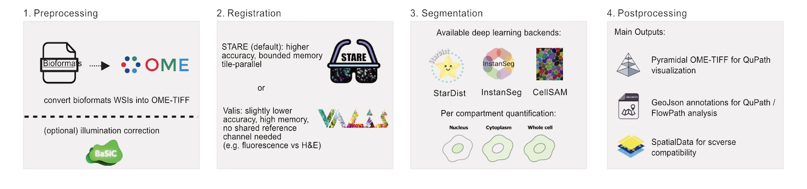

# MIRAGE

[](https://github.com/sceriff0/mirage/actions/workflows/ci.yml)
[](https://mirage-pipeline.readthedocs.io/)
[](https://www.nextflow.io/)
[](https://www.docker.com/)
[](https://sylabs.io/docs/)
[](LICENSE)

**From separately acquired staining rounds of one tissue section to a single-cell table.**
MIRAGE is a Nextflow pipeline for multiplexed immunofluorescence on whole slides. It aligns the
rounds at the scale of a nucleus ([STARE](https://github.com/sceriff0/stare) by default, VALIS as
the second mode), finds every cell (StarDist by default), measures every marker in nucleus,
cytoplasm and whole cell, and writes files that open directly in QuPath and in scverse tools.



## Quick start

**1. Install** Java 17 or newer, [Nextflow](https://www.nextflow.io/) 25.04.0 or newer, and
[Docker](https://docs.docker.com/get-docker/) (Apptainer/Singularity on a cluster). Every
analysis tool comes in a container. The images are built for Intel/AMD (`linux/amd64`) only; see
[Install](docs/installation.md) for Linux, macOS, Windows (WSL 2) and clusters.

```bash
git clone https://github.com/sceriff0/mirage.git
cd mirage
```

**2. Describe your slides** in `samplesheet.csv`, one row per image file:

```csv
patient_id,path_to_file,is_reference,channels
P001,/data/P001_round1.nd2,true,DAPI|PANCK|SMA
P001,/data/P001_round2.nd2,false,DAPI|CD45|CD163
```

| Column | Meaning |
|---|---|
| `patient_id` | The same label on every round of one section |
| `path_to_file` | Full path to the image (ND2, CZI, LIF, NDPI, SVS, OME-TIFF, …) |
| `is_reference` | `true` on exactly one row per patient; the other rounds are aligned onto it |
| `channels` | Channel names in acquisition order, separated by `\|`; every row contains the nuclear stain |

**3. Run.** On a laptop or workstation (4 CPUs, 16 GB, segmentation on the CPU):

```bash
nextflow run . -profile local,docker \
  -params-file params/no_gpu.json \
  --input samplesheet.csv --outdir results
```

On a SLURM cluster, after setting `max_cpus` and `max_memory` in your own `site.config`
(`cp conf/site.config.template site.config`):

```bash
nextflow run . -profile slurm,singularity -c site.config \
  --input samplesheet.csv --outdir results
```

If a run stops, repeat the command with `-resume`.

## What you get

Under `results/<patient_id>/`:

| File | What it is |
|---|---|
| `pyramid/pyramid.ome.tiff` | All rounds aligned into one multi-resolution image (QuPath, napari, OMERO) |
| `geojson/export/cells.geojson` | Every cell as a QuPath object with its measurements |
| `quantification/merged_quant.csv` | One row per cell: marker intensities and morphology |
| `spatialdata/<patient_id>.zarr` | The same cells as a SpatialData store for scverse tools |
| `qc/` | Before/after registration overlays and segmentation checks |

`results/qc/` holds an HTML report for the whole run. Cell types are called afterwards, in
QuPath, with [FlowPath](https://github.com/sceriff0/flowpath).

## Learn more

Full documentation: **<https://mirage-pipeline.readthedocs.io/>**
- [Your first run](docs/quickstart.md) — from an empty computer to a running pipeline
- [The samplesheet](docs/samplesheet.md) · [Choosing methods](docs/choosing_methods.md) ·
  [GPU or no GPU](docs/gpu.md) · [Running on a cluster](docs/hpc.md) ·
  [Troubleshooting](docs/troubleshooting.md)
- [The steps](docs/pipeline.md) · [Outputs](docs/outputs.md) ·
  [Parameters](docs/parameters.md) · [Resources](docs/resources.md)
- [The paper](docs/paper.md) · [Developing](docs/developing.md)

## Citation

If you use MIRAGE, cite the pipeline and the tools your run used; see
[`docs/citation.md`](docs/citation.md), [`CITATION.cff`](CITATION.cff) and
[`CITATIONS.md`](CITATIONS.md).

## Credits

MIRAGE, STARE and FlowPath are developed at the European Institute of Oncology (IEO), Milan, by
Valerio Fassi and Yinxiu Zhan with the Imaging and Screening Unit. Questions and bug reports: the
[issue tracker](https://github.com/sceriff0/mirage/issues).

## License

MIT. See [LICENSE](LICENSE).
