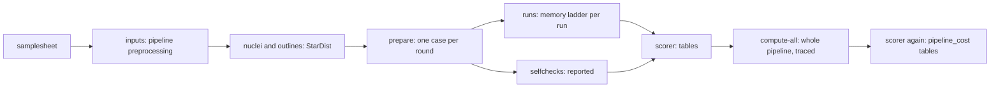

# Benchmarks

`regbench` (`benchmarks/regbench/`) is the official, and the only, benchmarking harness of
Mirage. It answers one question about registration, on the user's own cyclic-IF cohort:

> Given the same slides, how well does each registration method line up the same nuclei,
> and what does it cost?

Each method is run through **its own entry point**, with one of its own shipped parameter
sets, its own reader and its own writer, and is judged with the transform it estimated,
moved by its own code in its own direction. Every departure from that is listed per run in
`run.json: info.implementation.benchmark_side`. The full design, every number's definition
and every caveat are in
[`benchmarks/regbench/README.md`](https://github.com/sceriff0/mirage/blob/main/benchmarks/regbench/README.md);
this page is the overview.

!!! note "Nothing here has run on the cluster yet"
    The harness is tested against stand-ins (small trees laid out like the pipeline's
    published output, recording stand-ins for each method's package) and through the
    launcher's dry run. The first real run is the selfcheck inside each method's image.

## The cohort

One dataset, `multiplex`: the cohort's patients, each with one reference round and one or
more moving rounds. regbench builds its own inputs, so no other benchmark has to have run:

1. **The input step** runs the pipeline's own preprocessing on the cohort's samplesheet
   (one Nextflow head job). `pixel_size` is pinned to 0.325 µm; everything else is the
   shipped default.
2. **The nuclei step** runs the pipeline's StarDist on each native slide (nuclear channel
   only) and traces the cell mask, the nuclei grown by 10 px, to the slide's outlines, the
   way the pipeline's QC traces them. These outlines are the headline set; the bare nuclei
   are scored beside them.
3. **`prepare`** writes one case per moving round. Every input carries a fingerprint, so a
   case prepared from other files than the ones now on disk is recognised.

## The runs

`python -m benchmarks.regbench runs` prints the run list: 45 runs, of which six are the
primary rows the summary opens on.

| method | primary row | other rows |
|---|---|---|
| STARE | `stare` | strides 64, 128, 256 x preprocessing none / CLAHE / percentile |
| VALIS (the pipeline's call, 1.0.0) | `valis_mirage` | |
| VALIS 1.2.0 as shipped | `valis120_hires` | `valis120` |
| DeeperHistReg 1.0.1 | `deeperhistreg_hr_gpu` | eight labels, one row each: the image its writer draws, which sits about S/2 px plus a whole-pixel padding term (roughly 1 to 3 µm on the cohort) off its own registration |
| ASHLAR 1.20.0 | `ashlar` | clean, affine-anchored and a 20-cell factorial |
| PALOM | `palom` | |

## The scorer

The scorer reads files only. For each case and run it pairs the nuclei moved by the
method's transform with the other slide's nuclei (the pipeline's own pairing), and reports
the pair fraction, matched Dice, IoU, the share of nuclei within 1 µm of a partner and the
centroid displacement, beside a null (the same nuclei shifted four radii). Numbers are per
patient, with paired differences and a bootstrap interval over patients. **No ranking is
claimed.** A round a method failed is scored at the unregistered pose; a round lost for a
cause that is not the method's (the scheduler, the benchmark's own step) is left out and
named.

The **selfcheck** (do a method's points follow the image its own writer drew, on a
generated pair) and the **realcheck** (the same on a real case) are *reported, never a
gate*: no run waits for them, no run is kept from starting, and no row is dropped. Each row
carries its run's verdict in the tables (`selfcheck_status`, from `logs/verdicts.tsv`).

## Cost

Cost is measured by regbench, per method and per patient, in CPU-hours and memory-hours
(one definition of an attempt for every method) and in time, with the memory ladder's
retries counted. The cost by step (`cost_end_to_end.csv`) and the tissue-level agreement of
the written images are secondary views.

### Full pipeline cost (compute-all, secondary)

`submit_cohort.sh --compute-all` also runs the **whole** pipeline once per patient and
registration backend (`valis`, `tiled`), traced by Nextflow, alone on its lanes after the
scorer. It writes `pipeline_cost.csv`, `pipeline_cost_summary.csv` and
`pipeline_cost_by_process.csv`, and a block in `summary.md`.

- It runs at the shipped defaults of `nextflow.config` and the site profile, except
  `seg_method=stardist` and `pixel_size=0.325`. Registration therefore runs at the shipped
  tier `memory_mode='high'` unless the site profile overrides it; the cost may differ from
  the site's production settings.
- The `all` row's wall time is the **sum** of the per-patient values and includes SLURM
  queue time; the realtime-based CPU-hours do not. It is a different clock from the
  methods' registration cost, so no total adds the two.

## How to launch it

On a cluster, from a login node (the README has every variable and the first-submission
checklist):

```bash
benchmarks/regbench/slurm/submit_cohort.sh --inputs      # the pipeline's preprocessing
benchmarks/regbench/slurm/submit_cohort.sh --prepare     # outlines and cases
benchmarks/regbench/slurm/submit_cohort.sh --dry-run     # what would be submitted
benchmarks/regbench/slurm/submit_cohort.sh               # every run, then the scorer
benchmarks/regbench/slurm/submit_cohort.sh --compute-only   # the full pipeline cost
```



The whole harness is drawn in one figure, from the inputs to the tables and the caveats:
[regbench harness map](figures/regbench-harness.html){ target=_blank }. The benchmarking
panel of the [pipeline figure](figures/pipeline-schematic.html){ target=_blank } points to it.

Locally, the harness's test suite and the run list:

```bash
make regbench-test    # the full benchmark test suite
make regbench-runs    # python -m benchmarks.regbench runs
make regbench-dry     # the launcher's dry run
```

The earlier arm benchmark, sweep, figure launchers and analysis layer were removed; they
are kept at the git tag `archive/benchmarks-arms-sweep` (see `benchmarks/README.md`).
