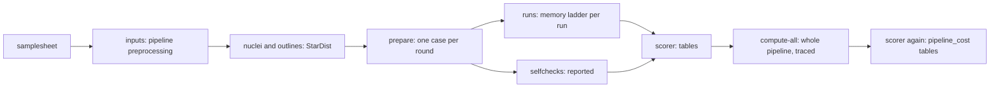

# Benchmarks

`regbench` (`benchmarks/regbench/`) is the official, and the only, benchmarking harness of
Mirage. It answers one question about registration, on the user's own cyclic-IF cohort:

> Given the same slides, how well does each registration method line up the same nuclei,
> and what does it cost?

Each method is run through **its own entry point**, with one of its own shipped parameter
sets, its own reader and its own writer, and is judged with the transform it estimated,
moved by its own code in its own direction. Every departure from that is listed per run in
`run.json: info.implementation.benchmark_side`. The full design, every number's definition
and every caveat are in
[`benchmarks/regbench/README.md`](https://github.com/sceriff0/mirage/blob/main/benchmarks/regbench/README.md);
this page is the overview.

!!! note "What has run"
    The benchmark has been run on the cluster on eight cases. The manuscript reports 64
    scored round pairs (78 were registered; two stains outside the nine-round protocol
    were registered with the others and not scored); see
    [Results reported in the manuscript](#results-reported-in-the-manuscript). The
    compute-all step (the whole pipeline, traced) is not part of those results, and the
    harness README still records it as not run on the cluster.

## The cohort

One dataset is scored for accuracy, `multiplex`: the cohort's patients, each with one
reference round and one or more moving rounds. (A second, `synthetic`, is a generated set
of image sizes scored for cost alone, with the runs `stare`, `valis120` and
`valis120_hires`.) regbench builds its own inputs, so no other benchmark has to have run:

1. **The input step** runs the pipeline's own preprocessing on the cohort's samplesheet
   (one Nextflow head job). `pixel_size` is pinned to 0.325 µm; everything else is the
   shipped default.
2. **The nuclei step** runs the pipeline's StarDist on each native slide (nuclear channel
   only) and traces the cell mask, the nuclei grown by 10 px, to the slide's outlines, the
   way the pipeline's QC traces them. These outlines are the headline set; the bare nuclei
   are scored beside them.
3. **`prepare`** writes one case per moving round. Every input carries a fingerprint, so a
   case prepared from other files than the ones now on disk is recognised.

## The runs

`python -m benchmarks.regbench runs` prints the run list: 11 runs on the cohort, the ones
the manuscript reports (`variants.REPORTED_RUNS`). Five of them write the primary rows the
summary opens on (`variants.PRIMARY`), and those five are the method rows of the
manuscript's Fig. 3.

| method | primary row (Fig. 3) | other active runs and the rows they write |
|---|---|---|
| STARE 1.3.0, default parameters | `stare` | `stare_rigid` (the rigid anchor alone, from the same run); `stare_local4` (the same registration as one 4-CPU job, a cost row) |
| VALIS 1.2.0 as shipped | `valis120`: the default `register()` | `valis120_rigid` and `valis120_micro` (`register_micro()`) from the same run; `valis120_hires` (the high-resolution example of the VALIS documentation), with `valis120_hires_rigid` and `valis120_hires_nonrigid` |
| PALOM 2026.4.1, documented recipe | `palom` | `palom_affine` (its affine stage, from the same run) |
| DeeperHistReg 1.0.1, high-resolution preset | `deeperhistreg_hr_fluo_cpu`: fluorescence setting, CPU | `deeperhistreg_hr_cpu`, `deeperhistreg_hr_gpu`, `deeperhistreg_hr_fluo_gpu`. Every DeeperHistReg row is scored on the image its writer draws, which sits about S/2 px plus a whole-pixel padding term (roughly 1 to 3 µm on the cohort) off its own registration |
| ASHLAR 1.20.0 as shipped, 15 µm maximum shift | `ashlar` | `affine_ashlar` (the moving pseudo-FOVs placed by STARE's rigid anchor first) |

The whole design is 99 runs. The other 88 are paused and listed by `runs --all`: the
STARE stride, preprocessing and tier cells, DeeperHistReg's 4,096 px preset, and ASHLAR
without reference noise and at other shifts and noise levels. The pipeline's own VALIS
1.0.0 call (`valis_mirage`) was retired and is in neither list.

## The scorer

The scorer reads files only. For each case and run it moves the nuclei of one slide
through the method's transform, in the direction the method defines it, and pairs them
with the other slide's nuclei by the pipeline's own pairing: a linear sum assignment
within each connected component of the candidate pairs (most pairs first, then least total
centroid distance), and mutual nearest neighbour in a component of more than 5,000 cells.
A pair is admissible when its centroids lie within 1.5 times the median equivalent radius
of the two native sets. Every number is computed on two polygon sets: the outlines (each
nucleus grown by 10 px, the headline) and the bare nuclei.

Per case and row it reports:

- the **pair fraction** (pairs over the smaller native count; the manuscript's matched
  fraction);
- the **matched Dice**, 2 x the summed intersection over the summed areas of the matched
  pairs, rasterized at twofold supersampling (on the outlines, the manuscript's
  matched-pair nuclear Dice);
- the IoU median and the share of pairs with IoU of at least 0.5;
- the **centroid displacement** of the matched pairs in µm, as median and 90th percentile
  (the manuscript's residual centroid distance);
- the share of nuclei with a partner centroid within 1 µm (pairing-free);
- a null (the same nuclei shifted four radii, over eight directions), and the same scores
  under mutual nearest neighbour alone and under the exact assignment in every component.

`summary.md` is per patient (a patient's rounds are reduced to their median), with paired
differences against `stare` and a bootstrap interval over patients. The scorer computes no
p-value and prints "descriptive; no ranking is claimed". The manuscript's tests are a
separate step on the scorer's tables, `python -m benchmarks.regbench.paper.accuracy_stats`:
on the 64 round pairs of the nine-round protocol, a two-sided Wilcoxon signed-rank test of
STARE against each other row, Holm-corrected, and the same test repeated on the eight
per-case medians.

A round a method failed is scored at the unregistered pose; a round lost for a cause that
is not the method's (the scheduler, the benchmark's own step) is left out and named.

The **selfcheck** (do a method's points follow the image its own writer drew, on a
generated pair) and the **realcheck** (the same on a real case) are *reported, never a
gate*: no run waits for them, no run is kept from starting, and no row is dropped. Each row
carries its run's verdict in the tables (`selfcheck_status`, from `logs/verdicts.tsv`).

## Cost

Cost is measured by regbench, per method and per patient, in CPU-hours and memory-hours
(one definition of an attempt for every method), in time and in peak memory, with the
memory ladder's retries counted. The scope is the registration: the method's own writer
is measured apart.

- **CPU time** per patient is the sum over the registration's jobs.
- **Peak memory** per patient is that of the largest registration job. For a method run
  as one process it is the sampled resident set of the process tree; for STARE's stage
  jobs it is the largest single job (anchor, tile or solve), a different instrument.
- **Memory requests.** STARE's stage jobs ask what the harness's allocation table gives
  them (`stages.ALLOCATION`: anchor 2 GB, tile task 4 GB, solve 1 GB, resampling 4 GB,
  multiplied by the attempt number). Every other job climbs a ladder of 16, 64, 256, 512
  and 700 GB: a job killed for memory is run again one rung up. A run can start higher
  (`REGBENCH_FIRST_RUNG`; the manuscript's VALIS runs started at 256 GB).

The cost by step (`cost_end_to_end.csv`) and the tissue-level agreement of the written
images are secondary views.

### Full pipeline cost (compute-all, secondary)

`submit_cohort.sh --compute-all` also runs the **whole** pipeline once per patient and
registration backend (`valis`, `tiled`), traced by Nextflow, alone on its lanes after the
scorer. It writes `pipeline_cost.csv`, `pipeline_cost_summary.csv` and
`pipeline_cost_by_process.csv`, and a block in `summary.md`.

- It runs at the shipped defaults of `nextflow.config` and the site profile, except
  `seg_method=stardist` and `pixel_size=0.325`. Registration therefore runs at STARE's
  one default configuration (2,048 px tile core, 64 px stride; the tiers and
  `reg_tiled_mode` were removed from `nextflow.config`), and VALIS at valis-wsi 1.2.0's
  own defaults (`reg_valis_mode='default'`), unless the site profile overrides them; the
  cost may differ from the site's production settings.
- The `all` row's wall time is the **sum** of the per-patient values and includes SLURM
  queue time; the realtime-based CPU-hours do not. It is a different clock from the
  methods' registration cost, so no total adds the two.

## How to launch it

On a cluster, from a login node (the README has every variable and the first-submission
checklist):

```bash
benchmarks/regbench/slurm/submit_cohort.sh --inputs      # the pipeline's preprocessing
benchmarks/regbench/slurm/submit_cohort.sh --prepare     # outlines and cases
benchmarks/regbench/slurm/submit_cohort.sh --dry-run     # what would be submitted
benchmarks/regbench/slurm/submit_cohort.sh               # every run, then the scorer
benchmarks/regbench/slurm/submit_cohort.sh --compute-only   # the full pipeline cost
```



The whole harness is drawn in one figure, from the inputs to the tables and the caveats:
[regbench harness map](figures/regbench-harness.html){ target=_blank }. The benchmarking
panel of the [pipeline figure](figures/pipeline-schematic.html){ target=_blank } points to it.

Locally, the harness's test suite and the run list:

```bash
make regbench-test    # the full benchmark test suite
make regbench-runs    # python -m benchmarks.regbench runs
make regbench-dry     # the launcher's dry run
```

## Results reported in the manuscript

The six rows of the manuscript's Fig. 3, from its Supplementary Table 2: n = 64 round
pairs from eight cases. Accuracy is the median (IQR) over round pairs; cost is the median
(range) over the eight cases.

| method | matched-pair nuclear Dice, median (IQR) | residual centroid distance, median (IQR), µm | peak RSS per case, GB, median (range) | CPU time per case, h, median (range) |
|---|---|---|---|---|
| Unregistered | 0.51 (0.49-0.51) | 3.65 (3.43-3.75) | - | - |
| STARE 1.3.0, default parameters | 0.84 (0.82-0.86) | 0.63 (0.49-0.73) | 0.7 (0.68-1.2) | 3.3 (0.6-7.5) |
| VALIS 1.2.0 as shipped, default `register()` | 0.80 (0.76-0.83) | 0.96 (0.83-1.28) | 31.6 (17.2-51.4) | 1.4 (0.4-1.8) |
| PALOM 2026.4.1, documented recipe | 0.80 (0.78-0.82) | 1.06 (0.85-1.20) | 5.4 (1.8-7.7) | 0.4 (0.1-0.5) |
| DeeperHistReg 1.0.1, high-resolution preset, fluorescence setting, CPU, scored on the written image | 0.77 (0.71-0.79) | 1.33 (1.20-1.84) | 13.5 (5.0-20.2) | 36.4 (6.2-58.1) |
| ASHLAR 1.20.0 as shipped, maximum shift 15 µm | 0.76 (0.69-0.80) | 1.30 (1.08-1.94) | 6.6 (1.9-9.5) | 0.4 (0.1-0.6) |

STARE ranked first on both accuracy measures against every other row (two-sided Wilcoxon
signed-rank test on the 64 paired round pairs, Holm-corrected, and again on the eight
per-case medians). These are the manuscript's numbers; `summary.md` of a run is the
harness's own output, which pools per patient and claims no ranking.

The earlier arm benchmark, sweep, figure launchers and analysis layer were removed; they
are kept at the git tag `archive/benchmarks-arms-sweep` (see `benchmarks/README.md`).

<!-- Provenance: numbers transcribed from the manuscript draft dated 2026-11-06, main text and Supplementary Table 2, read in full on 2026-11-13 [FULL]. -->
