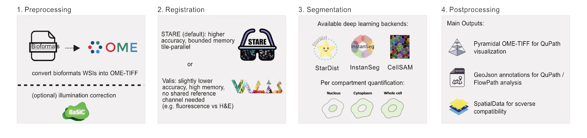

---
hide:
  - navigation
  - toc
---

<div class="mirage-hero" markdown>

<div class="kick">Whole-slide multiplexed immunofluorescence</div>

# MIRAGE

From separately acquired staining rounds of one tissue section to a single-cell table: MIRAGE
aligns the rounds at the scale of a nucleus, finds every cell, measures every marker, and writes
files that open in QuPath and scverse.

<div class="mirage-badges" markdown>
[Your first run :octicons-arrow-right-24:](quickstart.md){ .md-button .md-button--primary }
[What a run produces](outputs.md){ .md-button }
[The paper](paper.md){ .md-button }
[:fontawesome-brands-github: Source](https://github.com/sceriff0/mirage){ .md-button }
</div>

</div>



## Where to start

<div class="paths" markdown>

<div class="path" markdown>
<div class="who">I have slides and little coding experience</div>

Start from an empty computer: install three things, fill in one table, paste one command.

[Your first run](quickstart.md)
</div>

<div class="path" markdown>
<div class="who">I run pipelines on a cluster</div>

Apptainer, SLURM, job sizing, offline nodes, checkpoints.

[Running on a cluster](hpc.md) · [Checkpoints & resuming](resuming.md) · [Parameters](parameters.md)
</div>

<div class="path" markdown>
<div class="who">I want to know how it works</div>

Every process in order, the registration method, the resource model, and what the paper measured.

[The pipeline](pipeline.md) · [The paper](paper.md) · [Resources](resources.md)
</div>

</div>

## What a run does

<div class="stages" markdown>

<div class="stage" markdown>
<div class="n">1</div>
**Preprocessing**

Reads each round (ND2, CZI, LIF, NDPI, SVS, TIFF, HDF5 and more) and writes it as OME-TIFF with
the nuclear stain first. Illumination correction with BaSiC is optional and off by default.
</div>

<div class="stage" markdown>
<div class="n">2</div>
**Registration**

Aligns every round of a patient onto one reference round. **STARE**, the default, measures
displacements tile by tile and fits one slide-wide field; VALIS is the second mode.
</div>

<div class="stage" markdown>
<div class="n">3</div>
**Segmentation**

Finds nuclei and whole cells on the registered image. **StarDist** with MIRAGE's trained model
is the default; InstanSeg and CellSAM are one flag away.
</div>

<div class="stage" markdown>
<div class="n">4</div>
**Postprocessing**

Measures every marker per cell in nucleus, cytoplasm and whole cell, and exports a pyramidal
OME-TIFF, QuPath GeoJSON and a SpatialData store.
</div>

</div>

The four stages run in this order and each can be restarted on its own. MIRAGE stops at
quantified cells: cell types are called afterwards, in QuPath, with
[FlowPath](https://flowpath.readthedocs.io/).

## The command

```bash
nextflow run . -profile local,docker \
  -params-file params/no_gpu.json \
  --input samplesheet.csv --outdir results
```

That is a complete run at the defaults on a laptop or workstation.
[Your first run](quickstart.md) explains each part and gives the cluster form.

## Why STARE is the default

Each STARE task reads a fixed window, so its memory does not grow with the slide, and it
needs no GPU. On the paper's eight cases it reached a higher matched-pair nuclear Dice than VALIS at a fraction of the
memory; [Choosing methods](choosing_methods.md#registration-stare-or-valis) gives the
numbers and when to pick VALIS instead.

## Find your way

<div class="grid cards" markdown>

-   :material-play-circle-outline:{ .lg .middle } **Your first run**

    ---

    Install, describe your slides, run, open the results.

    [:octicons-arrow-right-24: Get started](quickstart.md)

-   :material-table:{ .lg .middle } **The samplesheet**

    ---

    One row per image file: the columns, the rules, the formats that are read.

    [:octicons-arrow-right-24: Samplesheet](samplesheet.md)

-   :material-call-split:{ .lg .middle } **Choosing methods**

    ---

    STARE or VALIS, StarDist, InstanSeg or CellSAM, illumination correction on or off.

    [:octicons-arrow-right-24: Choosing methods](choosing_methods.md)

-   :material-file-tree:{ .lg .middle } **Outputs**

    ---

    Every file a run writes, and how the measurement columns are named.

    [:octicons-arrow-right-24: Outputs](outputs.md)

-   :material-check-decagram-outline:{ .lg .middle } **Checking registration**

    ---

    The overlays and the per-round scores a run reports about its own alignment.

    [:octicons-arrow-right-24: Registration QC](registration_qc.md)

-   :material-tune:{ .lg .middle } **Parameters**

    ---

    Every setting, grouped by stage, with its default.

    [:octicons-arrow-right-24: Reference](parameters.md)

-   :material-sitemap:{ .lg .middle } **The pipeline**

    ---

    Every process in execution order, with six schematics of the hard parts.

    [:octicons-arrow-right-24: How it works](pipeline.md)

</div>

!!! note "When the docs and the code disagree"
    The code wins:
    [`nextflow.config`](https://github.com/sceriff0/mirage/blob/main/nextflow.config) holds every
    default. Please [open an issue](https://github.com/sceriff0/mirage/issues) if you find a
    mismatch.
